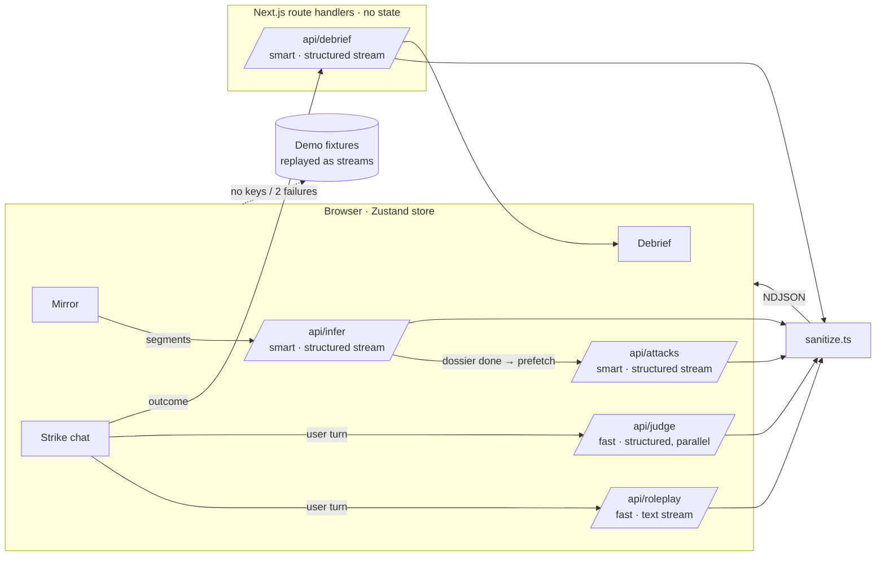

# Antibody

**See the scam built for you — before a scammer does.**

Antibody builds the exact scam a criminal would craft from *your own* public footprint, runs it on you in a safe, clearly-labelled simulation, then replays the precise moment you'd have been compromised and gives you a personal fix list. It's grounded in inoculation theory / prebunking: controlled exposure to a weakened form of manipulation builds resistance (Roozenbeek & van der Linden's *Bad News* game). Generic awareness tools tell everyone the same thing; Antibody makes the dose personal. India-first: digital-arrest calls, fake KYC alerts, "Papa on a new number", courier fees, fake jobs, UPI collect requests.

Built for **HACKCOM 26: Building a Safer Digital World**.

## Three stages, one flow

1. **Mirror**: paste your bio, posts and app list. An agent builds the attacker's dossier, and every inference cites the exact span of text it came from (with two-way hover linking).
2. **Strike**: the agent designs the 3 scams most likely to work on you. Pick one and chat with a scammer agent while a separate judge model tags each tactic and tracks your compromise risk.
3. **Debrief**: replay the conversation on a timeline, see the decisive moment, every tactic named, and a fix checklist that lowers your exposure score as you tick it.

## Safety guardrails (product features)

| Guardrail | How it's enforced |
|---|---|
| Own data only | A required consent checkbox gates the Analyze button. |
| No scraping, no lookup | There's no input for a name, phone, URL or handle, and no web-search tool anywhere in the pipeline. Only pasted text is analysed. |
| Can't send anything | No email/SMS/WhatsApp/call integration exists. |
| Watermarked artifacts | Every chat renders inside a `SIMULATION · ANTIBODY` frame with a diagonal watermark. Links are inert (non-clickable, with a warning tooltip). |
| Sim-only contact details | Prompts require `*.antibody.sim`, `+91 00000 00000`, `@antibody-sim`. **`lib/ai/sanitize.ts`** then rewrites any real-looking URL, Indian phone number, email or UPI ID in every payload server-side, *before* it streams to the client (streams hold back the trailing word so nothing leaks half-formed). |
| No real impersonation | Prompts forbid real banks, companies, officials and helplines. Personas are categories only. |
| Real-data guard | The client blocks messages that look like a card number, Aadhaar, PAN or password, blurs the composer and ends the run as COMPROMISED. The secret is never stored or sent. |
| Ephemeral | No database. State lives in memory (mirrored to `sessionStorage`). **Wipe everything** aborts in-flight requests and clears it all. |

Every debrief ends with: **call 1930 or report at cybercrime.gov.in**.

## Architecture



- **Everything streams.** Object routes use `streamText` + `Output.object` and emit sanitized partial objects as NDJSON. Dossier cards appear one by one as each inference completes.
- **Speculative prefetch.** `/api/attacks` fires the moment the dossier finishes, so scenarios are ready before you click.
- **Judge off the critical path.** Each user reply fires `/api/roleplay` and `/api/judge` in parallel. Tags animate in whenever they land.
- **Prompt caching.** The roleplay system prompt (rules + dossier + scenario) is a stable prefix marked with Anthropic `cacheControl`.
- **Abort everything.** Every request has an `AbortController`. Back-navigation, regenerate and wipe cancel them.
- **Retry with grace.** One silent retry, then "Reconnecting…", then the demo fixture for that step plus a toast. Raw errors never reach the UI.
- **rAF batching.** Stream snapshots are coalesced to one store write per animation frame. Components subscribe with selectors, so a judge tag re-renders one message.

| Path | What |
|---|---|
| `lib/ai/models.ts` | Every model choice (single source of truth) |
| `lib/ai/prompts.ts` | All system prompts |
| `lib/ai/sanitize.ts` | Output filter |
| `lib/ai/stream.ts` | NDJSON streaming, control-token parsing |
| `lib/schemas.ts` | Zod schemas shared by server validation, structured output and client types |
| `lib/store.ts` / `lib/pipeline.ts` | Zustand session store / client orchestration (abort, retry, fallback) |
| `lib/demo/*` | Sample profile, fixtures, scripted scammer + demo judge |
| `components/motion/presets.ts` | All motion presets |

## Setup

```bash
npm install
cp .env.example .env.local   # add any key(s); none = Demo Mode
npm run dev
```

Open http://localhost:3000.

### Environment variables

| Var | Tier |
|---|---|
| `GROQ_API_KEY` | Fast tier (roleplay, judge). Falls back to the smart tier's provider. |
| `ANTHROPIC_API_KEY` / `OPENAI_API_KEY` / `GOOGLE_GENERATIVE_AI_API_KEY` | Smart tier (dossier, scenarios, debrief). Falls back to the fast tier. |
| `SMART_MODEL`, `FAST_MODEL` | Model IDs. Required with an Anthropic key, optional overrides otherwise |

## Demo Mode

Demo Mode turns on when any of these happens:

- you visit `/lab?demo=1`
- you click **Watch the demo** on the landing page
- you toggle it in the ⌘K / Ctrl K palette
- no API keys are configured
- a stage fails twice

It replays hand-checked fixtures for the sample profile with realistic streaming timing. The scammer is scripted, with branches for resisting, wavering and complying, and the debrief is composed from what actually happened in your run, so Demo Mode looks the same as live mode.

`npm run record-fixtures` (with the dev server running and keys set) saves live outputs for the sample profile to `lib/demo/recorded/`. You can review them there and copy them into `lib/demo/fixtures.ts`.

## Checks

```bash
npm run check   # sanitizer + real-data guard cases, fixture span/quote integrity,
                # and the live streaming path with a mock model (no keys needed)
npm run lint && npm run build
```

## Credits and references

- Roozenbeek, J. & van der Linden, S. (2019). *Fake news game confers psychological resistance against online misinformation.* Palgrave Communications. https://doi.org/10.1057/s41599-019-0279-9
- [Vercel AI SDK](https://ai-sdk.dev) for structured output streaming
- [Motion](https://motion.dev), [Lenis](https://lenis.darkroom.engineering), [cmdk](https://cmdk.paco.me), [Sonner](https://sonner.emilkowal.ski), [Lucide](https://lucide.dev), [Geist](https://vercel.com/font)
- Border beam, number ticker, shimmer text, dot grid and animated beam are small in-house versions inspired by Magic UI / Aceternity UI patterns
- GoPhish was used only as a reference for how phishing simulations structure their reporting. Nothing here can send anything.
